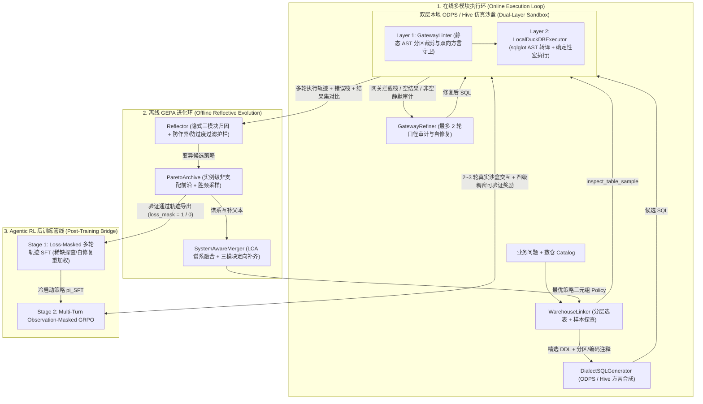

# EvoDW-RSI：面向企业数仓（ODPS / Hive）的 Text-to-SQL 策略自进化与多轮 Agentic RL 框架

[](https://github.com/Starchaser1024/EvoDW-RSI/actions/workflows/ci.yml)
[](pyproject.toml)

**EvoDW-RSI** 是一个面向企业级离线数仓（阿里云 MaxCompute ODPS / Apache Hive）的多模块 Text-to-SQL **反思式策略自进化（Reflective Strategy Self-Evolution）与多轮可验证奖励强化学习（Multi-Turn Agentic RLVR）**一体化框架。

受 ICLR 2026 Oral《GEPA: Reflective Prompt Evolution》启发，本框架构建了从**在线多模块推理与本地双层数仓沙盒验证**、**离线隐式模块归因与系统感知 Pareto 进化**，到**与下游多轮 Agentic SFT / GRPO 训练管线桥接**的完整自演进闭环：在不修改线上大模型参数的前提下沉淀零泄漏跨方言数仓策略，并将演进过程中的高纯度多轮工具交互与报错自修复轨迹内化至轻量级开源代码模型（1.5B / 3B / 7B）。

---

## 闭环系统架构



深度架构设计、AST 分区传播算法、防作弊/防方言退化状态机以及多轮 Observation Mask 梯度隔离推导详见 **[docs/ARCHITECTURE.md](docs/ARCHITECTURE.md)**。

---

## 核心技术亮点

1. **双角色异步 OpenAI 兼容客户端层（`src/llm/client.py`）**
   - `DualRoleLLMClient` 原生支持任意标准 OpenAI 兼容接口（`LLM_API_KEY` / `OPENAI_API_KEY`、`LLM_BASE_URL` / `OPENAI_BASE_URL`），解耦在线低延迟执行模型（`ACTOR_MODEL`）与离线强推理归因/融合模型（`REFLECTOR_MODEL`）。
   - 内置 `asyncio.Semaphore` 异步并发池控制、指数退避重试（`429` / `5xx`）、**JSON 长度截断自适应扩容重修（Adaptive Truncation Recovery）**、内容寻址 Reflector 响应缓存，以及按角色精确拆分的 Token/延迟账本（`UsageLedger`）。

2. **本地零成本 ODPS / Hive 双层数仓仿真沙盒（`src/env/`）**
   - **第一层：网关静态 AST 与跨方言拦截器（`gateway_linter.py` + `partition_pruning.py`）**
     - 递归遍历 CTE、子查询、`UNION` 与 `JOIN ON` 等价传播图，强制校验 `ods_*` / `dwd_*` / `dws_*` 分区表裁剪（`ds` / `dt`），精准拦截 `ds IS NOT NULL` 等伪过滤并返回真实报错码 `FAILED: ODPS-0123031: Partition exception ...`。
     - 双向方言越界守卫：ODPS 模式拦截 `DATE_FORMAT`、`DATE_ADD`、`IFNULL`、`JSON_EXTRACT`、`UNNEST`、两参数 `DATEDIFF` 及 `LIMIT offset, count`；Hive 模式反向拦截 `MAX_PT`、`DATEADD`、`TO_CHAR` 及三参数 `DATEDIFF`，杜绝跨方言幻觉。
   - **第二层：确定性 DuckDB 方言转译执行器（`local_executor.py`）**
     - 基于 `sqlglot` AST 与确定性 SQL 宏，毫秒级本地执行 ODPS / Hive 日期运算、`MAX_PT('table')`、`GET_JSON_OBJECT`（对脏 JSON 容错返回 `NULL`）、`LATERAL VIEW [OUTER] explode(...)` 与窗口去重，暴露统一 `evaluate_sql()` 与 `compute_reward()` 供进化环与强化学习共用。

3. **三模块自进化数仓 Agent（`src/agent/` & `prompts/seed/`）**
   - 策略由三元组 `Policy = {linker_prompt, generator_prompt, refiner_prompt}` 参数化：
     - `WarehouseLinker`：数仓分层选表并按需调用 `inspect_table_sample(table_name, columns)` 实时探查最新分区边界（`max_partition`）、非直观枚举编码映射、金额单位（分/元/基点）与 JSON 结构。
     - `DialectSQLGenerator`：跨粒度预聚合（防一对多扇出膨胀）、SCD Type-2 历史时点拉链对齐与多方言 SQL 生成。
     - `GatewayRefiner`：针对网关报错、运行异常、空结果以及**非空结果的静默口径审计（Post-Execution Sanity & Caliber Audit）**，执行最多 `max_refine_turns=2` 轮自修复。
   - `prompts/seed/` 初始种子保持极简零先验（不含任何 ODPS/Hive 分区或函数提示），客观检验系统自发习得企业数仓规范的能力。

4. **GEPA 反思式进化引擎与下游多轮 Agentic SFT / GRPO 训练管线桥接（`src/rsi/`, `src/export/`）**
   - `Reflector`（`attribution.py` + `dialect_guards.py`）：隐式三模块错误归因，内置**防泄漏护栏**（严禁硬编码题库表名、任务 ID、分区日期字面量及业务枚举码）、**防过度过滤护栏（Anti-Over-Filtering Guard）**及否定语境感知的方言违规自动修复。
   - `ParetoArchive` & `SystemAwareMerger`：维护实例级非支配 Pareto 前沿，基于最近公共祖先（LCA）合并互补父本并对未演化模块实施三模块定向补齐。
   - 零泄漏桥接导出（`rl_bridge.py`）：自动校验并增量合并 `train + val` 验证轨迹（显式标注 `loss_mask=1/0`）至 OpenAI Tool-Use / ShareGPT SFT 数据集与 GRPO Prompt 池，严格物理隔离全部 48 道 `test` 题。

5. **两阶段多轮工具交互 SFT + Observation-Masked Agentic GRPO（`src/rl/`）**
   - **Stage 1（`sft_dataset.py` + `sft_trainer.py`）**：`max_seq_length=9216` 零截断多轮轨迹微调，自适应稀缺重加权定向增强 `self_repaired_after_error` 与 `inspect_table_sample` 轨迹，且仅在 `loss_mask == 1` 位置投影 `lm_head` 计算 Cross-Entropy。
   - **Stage 2（`multiturn_rollout.py` + `grpo_engine.py` + `rewards.py`）**：支持 2~3 轮真实沙盒交互 Rollout，严格解耦因果注意力掩码（`completion_attn_mask=1` 保留沙盒报错可见性）与动作梯度掩码（`completion_mask=1` 仅作用于模型 Action Token，环境 Observation Token 严格零梯度 / 零 KL 泄露），配合四级递进稠密 + 自修复奖励驱动策略内化。

---

## 目录结构

```text
EvoDW-RSI/
├── .env.example
├── pyproject.toml                  # 注册统一 CLI 入口 `evodw`
├── requirements.txt                # 核心沙盒、AST 与进化引擎依赖
├── requirements-rl.txt             # PyTorch / PEFT / TRL 后训练依赖
├── .github/workflows/ci.yml        # Ubuntu & Windows 跨平台自动化测试与冒烟流水线
├── docs/
│   └── ARCHITECTURE.md             # 深度架构、AST 算法与 RL 掩码设计文档
├── prompts/seed/                   # 零先验初始三模块 System Prompts
├── src/
│   ├── cli.py & __main__.py        # 统一命令行入口 (`evodw` / `python -m src`)
│   ├── config.py                   # 环境变量与双角色模型配置中心
│   ├── llm/                        # client.py (DualRoleLLMClient), mock_client.py
│   ├── env/                        # schema.py, gateway_linter.py, partition_pruning.py, local_executor.py, sandbox.py
│   ├── agent/                      # policy.py, trajectory.py, linker.py, generator.py, refiner.py, pipeline.py
│   ├── benchmarks/                 # catalog_builder.py, dw_generator.py, hard_v2_populator.py, v1/*, hard_v2_tasks.py
│   ├── rsi/                        # attribution.py, dialect_guards.py, pareto.py, merger.py, scheduling.py, eval_cache.py, engine.py
│   ├── eval/                       # comparator.py, metrics.py, reporter.py
│   ├── export/                     # rl_bridge.py (SFT/GRPO 数据集导出与独立 reward_fn)
│   └── rl/                         # config.py, model_utils.py, sft_dataset.py, sft_trainer.py, multiturn_rollout.py,
│                                   # rewards.py, grpo_data.py, grpo_engine.py, grpo_trainer.py, hf_client.py, inference.py, eval_report.py
├── notebooks/
│   └── EvoDW_RL_Colab_A100.ipynb   # Colab A100/H100 一键实训 Notebook（含断连保护）
├── scripts/                        # 独立可运行实验脚本（与 `evodw` 子命令一一对应）
└── tests/                          # 网关/转译、120 题 Gold SQL、GEPA 进化护栏、多轮 RL 掩码全套离线单测
```

---

## 快速开始

### 1. 环境安装与健康诊断

```bash
pip install -r requirements.txt
# 若需运行本地小模型 SFT + 多轮 GRPO 后训练，额外安装 RL 依赖：
pip install -r requirements-rl.txt
pip install -e . --no-deps

cp .env.example .env
# 编辑 .env，配置标准 OpenAI 兼容网关的 LLM_API_KEY 与 LLM_BASE_URL（离线评测无需配置）

# 运行统一 CLI 环境与基准完整性自检
evodw doctor
# 校验冻结实验谱系清单（Cohort-v1 299/45 vs Cohort-v2 624/72）、零测试泄漏与统计置信区间
evodw audit-experiments
# 或使用模块方式调用：
python -m src --help
```

### 2. 离线单元测试与三题冒烟验证（零 API 消耗）

验证 ODPS/Hive 双层网关拦截器、DuckDB 方言转译器、15 张仿真数仓表与 120 道基准题 Gold SQL、GEPA 防泄漏/方言护栏，以及多轮 GRPO Observation Mask 零梯度隔离：

```bash
python -m pytest -q

# 运行 3 题端到端轨迹冒烟测试（未配置 LLM_API_KEY 时自动回退至确定性 Mock 模式）
python scripts/smoke_test.py
# 或强制连接实网 API 测试：
evodw smoke-test --live
```

### 3. 运行离线 GEPA 策略自进化与跨方言消融实验

```bash
# v1 基础套件（75 题）ODPS 三组消融对比（离线演练可加 --mock）
evodw evolve --suite v1 --dialect odps --budget 65 --method gepa --run-ablation

# Hard-v2 深水区静默口径陷阱套件（45 题）ODPS 消融对比（seed vs greedy vs gepa）
evodw evolve --suite hard_v2 --dialect odps --budget 115 --val-active-size 12 --method gepa --run-ablation

# Hard-v2 Hive 跨方言零先验自进化（seed vs gepa）
evodw evolve --suite hard_v2 --dialect hive --budget 105 --val-active-size 12 --method gepa

# 外部跨 Schema 基准（external_bird_mini：金融/医疗/教育 11 表 24 题）等预算四方法对比
# 同等 <=4 次调用上限下对比 direct_sql / exec_feedback / evodw_seed / evodw_gepa_transfer（离线验证加 --mock）
evodw compare-methods --suite external_bird_mini --dialect odps --max-calls 4 --mock
```

### 4. 运行多轮工具交互 SFT 与 Observation-Masked Agentic GRPO

```bash
# Stage 1: Loss-Masked 多轮轨迹 SFT 冷启动
# 注：当前 outputs/rl_export/ 已导出 Cohort-v2（v1 + Hard-v2 合并共 624 条验证轨迹 / 72 道 GRPO Prompt）；
# 下文冻结的 3B Colab 实验基于 Cohort-v1（v1 套件 299 条去重轨迹 -> 391 条重加权轮次 / 45 道 GRPO Prompt）训练。
evodw train-sft --model 3b --epochs 3 --max-seq-length 9216 --no-4bit --output-dir outputs/rl_checkpoints/sft

# Stage 2A: 4-Stage 稠密 + 自修复奖励多轮沙盒 GRPO 主模型（G=8, beta=0.04, 100 steps）
evodw train-grpo --model 3b --sft-checkpoint outputs/rl_checkpoints/sft \
    --num-generations 8 --max-steps 100 --beta 0.04 --ablate-reward full --no-4bit \
    --output-dir outputs/rl_checkpoints/grpo_dense

# Stage 2B: 纯稀疏结果奖励消融对照（Outcome-Only Sparse 0/1 EX Reward）
evodw train-grpo --model 3b --sft-checkpoint outputs/rl_checkpoints/sft \
    --num-generations 8 --max-steps 100 --beta 0.04 --ablate-reward outcome_only --no-4bit \
    --output-dir outputs/rl_checkpoints/grpo_sparse

# 隔离测试集统一评测（含 XiYanSQL-QwenCoder 垂直 SQL 模型对照）
evodw eval-rl --model 3b --vertical-model xiyansql-3b \
    --sft-dir outputs/rl_checkpoints/sft \
    --grpo-dir outputs/rl_checkpoints/grpo_dense \
    --grpo-sparse-dir outputs/rl_checkpoints/grpo_sparse \
    --resume
```

支持通过 `evodw pack-colab` 打包脱敏实训归档并在 Google Colab A100/H100 运行 [EvoDW_RL_Colab_A100.ipynb](notebooks/EvoDW_RL_Colab_A100.ipynb)，完成后通过 `evodw merge-colab` 合入评测曲线；同时提供 `evodw convert-bird --self-test` 将外部 BIRD SQLite 任务转换为带 `ds` 分区约束的数仓基准。

---

## 实验基准与消融评测结果

### 1. 企业数仓与外部跨 Schema 评测基准设计（26 张分层表 · 144 道任务）

| 基准套件 | 规模划分（Train / Val / Test） | 核心评测维度与高频深水区陷阱 |
|---|---|---|
| **`v1` 核心数仓套件** | **75 题**（`25 / 20 / 30`） | `partition_pruning`（多分区/异构 `ds`/`dt` 裁剪）、`json_array_unnest`（脏 JSON 与 `LATERAL VIEW OUTER explode`）、`retention_date_math`（跨月留存与双格式日期对齐）、`fanout_dedup`（一单多品×多次退货扇出膨胀与日志去重）、`ratio_null_handling`（冷启动除零与空串混杂） |
| **`Hard-v2` 静默口径陷阱套件** | **45 题**（`15 / 12 / 18`） | 专攻**“通过网关且非空返回，但业务口径静默算错”**：`semantic_linking_trap`（V1 废弃残表干扰与非直观枚举码/分元换算）、`scd2_temporal_join`（SCD Type-2 历史区间切片 vs `is_current=1` 误用）、`silent_caliber_audit`（`LEFT JOIN` 右表过滤退化、同分窗口帧缺失、压测/异常流量污染） |
| **`external_bird_mini` 外部跨领域数仓套件** | **24 题**（`6 / 6 / 12`，11 张表） | 建模自 BIRD Mini-Dev 三大非电商外部领域（零售信贷 `financial`、自身免疫临床住院 `thrombosis_clinical`、公立学校绩效 `california_schools`），含脏字符串比例、复合外键、异构 `ds`/`dt` 分区注入及每题逐项 SQLite->ODPS AST 转译台账，用于零微调检验已进化策略是否过拟合电商表名。 |

> **外部基准适配口径声明**：`external_bird_mini` 对事实表注入了 `ds`/`dt` 分区契约并将 SQLite 语法（`IFNULL`、`STRFTIME`、`LIMIT a, b`）转译为 ODPS/Hive AST；其得分用于衡量**跨 Schema 与企业数仓网关约束泛化能力**，**严禁与原始无分区 SQLite 环境下的 BIRD-bench 官方榜单分数直接混同对比**。

### 2. 在线 GEPA 策略自进化与跨方言消融（Actor: `deepseek-v4.1-flash` / Reflector: `deepseek-v4-pro`）

完整分项指标、演化谱系 DAG 与三模块 Prompt Diff 详见 [experiment_report.md](outputs/experiment_report.md)：

| Suite / Dialect | Method | Best Policy | Rollouts | Val EX | Test EX | Δ vs Seed | Test 1st-Pass GW | Test Invalid Rate | 核心实验发现 |
|---|---|---|---:|---:|---:|---:|---:|---:|---|
| `v1` / ODPS | `seed` | `seed_v0` | 0 | 85.0% | 93.3% | - | 66.7% | 0.0% | 首轮频繁遗漏分区裁剪触发 `ODPS-0123031` |
| `v1` / ODPS | `greedy` | `greedy_g4` | 59 | 95.0% | 96.7% | +3.3pp | 100.0% | 0.0% | 单链路贪心修复网关规范，仍留边界口径误差 |
| `v1` / ODPS | **`gepa`** | **`gepa_g3`** | 65 | **100.0%** | **100.0%** | **+6.7pp** | **96.7%** | **0.0%** | **65 次 rollout 内达成 Val & Test 双满分** |
| `Hard-v2` / ODPS | `seed` | `seed_v0` | 0 | 58.3% | 55.6% | - | 83.3% | 0.0% | 在隐藏编码、SCD2 日期错位与静默扇出上大量静默算错 |
| `Hard-v2` / ODPS | `greedy` | `greedy_g3` | 95 | 91.7% | 72.2% | +16.7pp | 100.0% | 0.0% | 单模块变异陷入局部最优，缺乏跨模块探查+审计协同 |
| `Hard-v2` / ODPS | **`gepa`** | **`gepa_g5`** | 111 | **100.0%** | **83.3%** | **+27.8pp** | **94.4%** | **0.0%** | **`SystemAwareMerger` 融合 `linker+generator` 后补齐 `refiner` 静默口径审计，领先 `greedy` +11.1pp** |
| `Hard-v2` / HIVE | `seed` | `seed_v0` | 0 | 66.7% | 44.4% | - | 77.8% | 16.7% | 幻觉调用 `MAX_PT`/`DATEADD`/`TO_CHAR` 导致高语法非法率 |
| `Hard-v2` / HIVE | **`gepa`** | **`gepa_g5`** | 96 | **100.0%** | **83.3%** | **+38.9pp** | **100.0%** | **0.0%** | **零先验习得纯正 Hive 探查与日期规范，Invalid Rate 降至 0.0%** |

### 3. 小模型多轮 SFT + Agentic GRPO 后训练评测（1.5B & 3B，隔离 `v1` Test = 30 题）

完整评测报告、训练动态与谱系校验清单详见 [rl_experiment_report.md](outputs/rl_experiment_report.md)、[rl_experiment_report_1_5b_v1.md](outputs/rl_experiment_report_1_5b_v1.md) 与 [EXPERIMENT_MANIFEST.json](outputs/EXPERIMENT_MANIFEST.json)（可通过 `evodw audit-experiments` 一键复核）：

| 模型规模与方案 | 训练预算（批次谱系） | Test EX (`Hits/30`) | 95% Wilson CI | First-Pass GW | Invalid SQL Rate | Avg Steps | 核心结论 |
|---|---|---:|---:|---:|---:|---:|---|
| `Qwen2.5-Coder-1.5B-Instruct` (Zero-shot) | - | 3.3% (`1/30`) | [0.6%, 16.7%] | 13.3% | 76.7% | 3.80 | 极小参数基座几乎无法遵循多模块 JSON 与分区契约 |
| `Qwen2.5-Coder-1.5B` + Loss-Masked SFT + GRPO (`v1`) | `Cohort-v0`: 85 trajs / 8 steps | **20.0%** (`6/30`) | [9.5%, 37.3%] | **60.0%** | 66.7% | 3.33 | 初步内化分区与 `explode` 语法（较 1.5B Base **+16.7pp EX**） |
| `Qwen2.5-Coder-3B-Instruct` (Zero-shot) | - | 10.0% (`3/30`) | [3.5%, 25.6%] | 30.0% | 56.7% | 3.73 | 频繁遗漏分区裁剪（`ODPS-0123031`）与方言函数混用 |
| `Qwen2.5-Coder-3B` + GEPA Evolved Prompt | 0（仅替换 Prompt） | 16.7% (`5/30`) | [7.3%, 33.6%] | 60.0% | 66.7% | 3.60 | 纯 Prompt 进化使首轮网关通过率翻倍，但受限于 3B 零样本推理上限 |
| `XiYanSQL-QwenCoder-3B-2504` (垂直 SQL SOTA 对照) | 开源垂直基座 | 16.7% (`5/30`) | [7.3%, 33.6%] | 46.7% | 76.7% | 1.00 | 通用 SQL SOTA 在私有数仓分区裁剪与 `explode`（`0.0%`）上显著水土不服 |
| **EvoDW Stage-1 SFT (`3B`, Loss-Masked Multi-Turn)** | `Cohort-v1`: 299 trajs (3 epochs) | **53.3%** (`16/30`) | [36.1%, 69.8%] | **93.3%** | **26.7%** | 2.67 | **较 3B Base 提升 +43.3pp EX（McNemar $p \le 0.001$），首轮网关达 93.3%** |
| EvoDW Stage-2A GRPO (`3B`, Outcome-Only Sparse 消融) | `Cohort-v1`: 45 prompts / 100 steps | 40.0% (`12/30`) | [24.6%, 57.7%] | 90.0% | 30.0% | 2.93 | 32.0% 训练步出现组内零方差梯度饥饿，留存类退化至 `0.0%`（`0/6`） |
| **EvoDW Stage-2B GRPO (`3B`, 4-Stage Dense + Self-Repair)** | `Cohort-v1`: 45 prompts / 100 steps | **46.7%** (`14/30`) | [30.2%, 63.9%] | **90.0%** | **26.7%** | 2.80 | **较稀疏奖励 +6.7pp EX**，零方差步降至 `6.0%`，`partition_pruning` 首轮网关达 **100%** 并逆转 `ja_11`、`rd_10` |
| 在线 Teacher (`deepseek-v4.1-flash` + GEPA) | 65 rollouts (`v1` ODPS) | **100.0%** (`30/30`) | [88.6%, 100.0%] | **96.7%** | **0.0%** | 2.17 | 在线多模块自进化系统上限基准 |

> **谱系对账与统计功效说明（Reproducibility & Statistical Caveats）**：
> 1. **批次谱系对账（`299` vs `624`）**：上表冻结的 3B 模型训练于 **`Cohort-v1`**（`v1` ODPS 进化产出的 `299` 条去重验证轨迹 -> 自适应重加权 `391` 轮 + `45` 道 `v1` GRPO Prompt）；仓库当前 `outputs/rl_export/` 为后续合入 `Hard-v2`（ODPS `253` 条 + Hive `72` 条）后的 **`Cohort-v2`**（共 `624` 条轨迹 / `72` 道 GRPO Prompt，全部 `48` 道 `test` 题严格零交集）。
> 2. **统计功效与 SFT vs GRPO 诊断**：在 `N=30` 测试集上，SFT（`16/30`）与 Dense GRPO（`14/30`）仅差 `2` 题（双侧精确 McNemar $p = 0.6875$，处于 95% Wilson CI 重叠区内，不可单凭点估计做强渐近排序断言）。真实训练日志显示 `Cohort-v1` 的 `45` 道 GRPO Prompt 中有 `84.4%`（`38/45`）已被 SFT 覆盖，第 `4` 步在线 EX 即达 `81.25%` 并在 Epoch $>1$ 出现轻微 KL 漂移（`0.00037 -> 0.01510`）与长度压缩权衡；而 4-Stage 稠密奖励将组内零方差步占比从稀疏奖励的 `32.0%`（`16/50`）压降至 `6.0%`（`3/50`），有效阻止了长链路留存题坍塌。下一阶段训练协议将在 `Cohort-v2`（`72+` 题）上引入 `0 < pass@8 < 1` 动态课程过滤与单 Epoch 早停。
