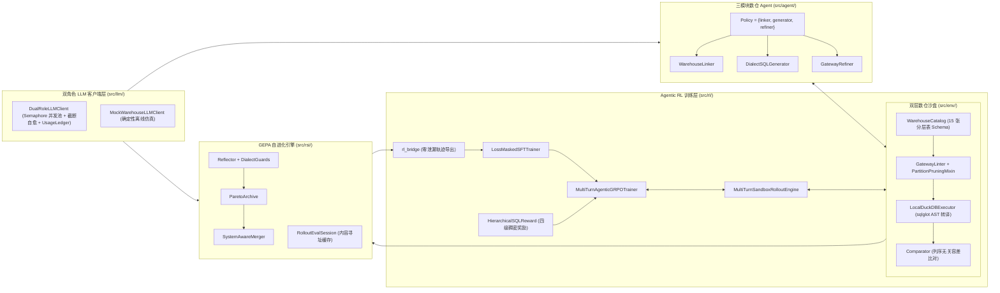
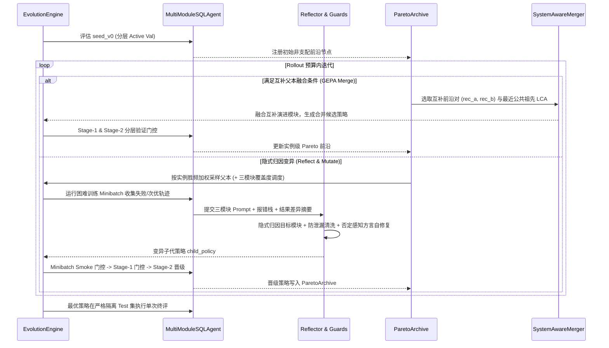

# EvoDW-RSI 系统架构与算法设计白皮书

本文档详细阐述 **EvoDW-RSI** 的核心工程架构、双层 ODPS/Hive 沙盒静态分析与转译机制、GEPA 三模块反思式进化算法，以及下游多轮工具交互 SFT 与 Observation-Masked Agentic GRPO 的数学建模与实现细节。

---

## 1. 设计目标与问题定义

企业级离线数据仓库（如阿里云 MaxCompute ODPS、Apache Hive）上的 Text-to-SQL 与通用学术基准（Spider / BIRD SQLite）存在本质的工程鸿沟：

1. **强网关准入约束**：对 `ods_*` / `dwd_*` / `dws_*` 增量或全量分区表执行查询时，网关在静态编译阶段强制检查 `WHERE` / `JOIN ON` 是否包含非平凡分区裁剪谓词（如 `ds = MAX_PT('table')` 或显式区间），否则直接抛出 `ODPS-0123031` 拒绝执行。
2. **严格的跨方言边界**：ODPS 与 Hive 在日期算术（3 参数 `DATEDIFF(end, start, 'dd')` / `DATEADD` / `TO_CHAR` vs 2 参数 `DATEDIFF(end, start)` / `DATE_ADD` / `DATE_FORMAT`）与最新分区探查（内置 `MAX_PT` vs 元数据探查）上互不兼容，通用模型极易产生跨方言幻觉。
3. **非空静默口径错误（Silent Caliber Traps）**：即使 SQL 通过语法检查并返回非空数据，仍常因未探查内部枚举编码（如 `'20_SETTLED'`）、分/元/基点单位未换算、SCD Type-2 拉链表历史日期格式错位、一单多品关联多笔退款产生笛卡尔扇出膨胀，或 `LEFT JOIN` 右表条件误写进 `WHERE` 而导致结果静默失真。

**EvoDW-RSI** 通过“**本地确定性双层沙盒 + 在线/离线双环策略自进化 + 多轮动作掩码强化学习**”系统性解决上述三类问题。

---

## 2. 端到端系统拓扑与模块职责

---

## 3. 本地双层数仓仿真沙盒（`src/env/`）

### 3.1 Layer 1：静态词法、方言与递归分区裁剪守卫（`gateway_linter.py` & `partition_pruning.py`）

`GatewayLinter` 在不触碰执行引擎的前提下复现生产网关的静态编译语义，按五步流水线依次拦截：

1. **词法流扫描（`_check_tokens`）**：捕获被 AST 解析器归一化的非法方言语法，包括 PostgreSQL `::` 类型强转、JSON 箭头操作符 `->` / `->>`、MySQL `LIMIT offset, count`，以及函数参数个数/日期单位合法性（例如 ODPS 强制 3 参数 `DATEDIFF(..., 'dd')`，Hive 强制 2 参数 `DATEDIFF(...)` 并禁止 `MAX_PT` / `DATEADD` / `TO_CHAR`）。
2. **单语句只读校验**：通过 `sqlglot.parse(..., read="hive")` 解析 AST，仅允许单条只读 `SELECT` / `UNION` 查询。
3. **笛卡尔积守卫（`_check_joins`）**：拦截隐式逗号连接、无 `ON`/`USING` 的连接，以及 `ON 1=1` / `ON TRUE` 等恒真连接条件（返回 `ODPS-0123055`）。
4. **递归分区裁剪与等价类传播（`PartitionPruningMixin._check_partition_pruning`）**：
   - 维护局部 CTE 符号表（区分物理分区表与 CTE 引用），递归检查所有嵌套 `WITH`、`UNION`、标量子查询与派生表。
   - 在每个 `Select` 作用域提取 `WHERE` 与 `JOIN ON` 的合取范式（CNF）谓词：
     - **反作弊过滤**：显式拒绝 `ds IS NOT NULL`、`ds != ''`、`ds LIKE '%'` 等试图绕过网关的全表扫描伪谓词；对于 `OR` 析取式，仅当左右分支均裁剪同一别名时才认定该别名已被裁剪。
     - **跨表连接传播**：当存在 `a.ds = b.ds` 或 `b.ds = DATEADD(a.ds, ...)` 等跨表分区键连接边时，在别名等价图上执行不动点传播，确保关联分区表与事实主表协同受控。

### 3.2 Layer 2：确定性 DuckDB 方言转译执行器（`local_executor.py`）

通过预处理重写与 DuckDB 原生确定性宏结合，实现毫秒级内存执行且无需任何外部集群依赖：

- **元数据绑定重写**：在 SQL 执行前解析 `MAX_PT('table_name')` 并查询物理表分区列最大值完成静态替换；将 `LATERAL VIEW [OUTER] explode(arr) t AS col` 精准重写为保留空数组语义的 `CROSS JOIN UNNEST(...)` 或 `LEFT JOIN UNNEST(CASE WHEN len(arr)=0 THEN [NULL] ELSE arr END)`。
- **跨方言日期与 JSON 宏**：内置兼容 ODPS 格式符（`'yyyymmdd'` / `'yyyy-mm-dd'`）与 Hive 格式符的 `TO_DATE`、`TO_CHAR`、`DATE_FORMAT`、`DATEADD`、`DATEDIFF` 宏，以及对残损 JSON 字符串安全返回 `NULL` 而不抛运行期崩溃的 `GET_JSON_OBJECT`。

---

## 4. 在线三模块 Agent 与离线 GEPA 自进化引擎（`src/agent/`, `src/rsi/`）

### 4.1 在线三模块协作契约

| 模块 | 输入上下文 | 允许动作 / 输出 JSON 契约 | 核心工程职责 |
|---|---|---|---|
| `WarehouseLinker` | 问题 + Hint + 15 表轻量摘要 | `action="probe"`（调用 `inspect_table_sample`）或 `action="finalize"`（输出 `selected_tables` + `schema_notes`） | 区分新旧同名表、实时探查分区上界（尤其 Hive 模式）、发现隐藏状态码与分/元/bps 单位 |
| `DialectSQLGenerator` | 精选表 DDL + 探查样本 + `schema_notes` | `{"thought": "...", "sql": "..."}` | 按粒度 CTE 预聚合防扇出、SCD2 区间日期格式对齐、目标方言合规 SQL 生成 |
| `GatewayRefiner` | 前序 SQL + 沙盒执行/报错摘要 + 最多 5 行结果样本 | `{"thought": "...", "diagnosis": "...", "sql": "..."}` | 修复网关/运行期错误，并对非空结果执行 **Post-Execution Sanity & Caliber Audit** |

### 4.2 离线 GEPA 双阶段验证与三模块协同进化

关键算法保障：
- **内容寻址评估缓存（`RolloutEvalSession`）**：以 `(SHA256(dialect + 3 prompts), task_id)` 为键持久化轨迹，使消融实验与断点续跑零重复计费。
- **否定语境感知方言守卫（`dialect_guards.py`）**：区分正向误用（如推荐使用 `DATE_FORMAT`）与负向警示（如 `"Never use DATE_FORMAT; instead use TO_CHAR"`），在不破坏负向约束的前提下自动将违规示例修复为目标方言等价写法。
- **防作弊与防过度过滤护栏（`attribution.py`）**：自动剥离任何题库表名、任务 ID、日期字面量或特定枚举值硬编码，禁止模型凭空添加未请求的生命周期状态过滤条件。

---

## 5. 多轮工具交互 SFT 与 Observation-Masked Agentic GRPO（`src/rl/`）

### 5.1 零泄漏数据桥接与稀缺轨迹自适应重加权（`rl_bridge.py` & `sft_dataset.py`）

- **物理级测试集隔离**：`load_sft_trajectories()` 与 `load_grpo_prompts()` 在加载时强制比对全量 48 道 `test` 任务 ID 黑名单，一旦混入任何测试题立即抛出 `ValueError` 中止训练。
- **精确 Token 级 Loss Masking**：在多轮 ChatML 序列中，所有 `system`、`user`、`tool`（含 `inspect_table_sample` 返回的样本 JSON 与 `sandbox_execute` 返回的 `ODPS-0123031` 报错栈）以及 `<|im_start|>assistant\n` 角色头均被标记为 `labels = -100`；`LossMaskedSFTTrainer` 仅抽取 `shift_labels != -100` 的隐藏状态投影 `lm_head`，消除长上下文冗余显存开销。
- **稀缺能力重加权**：针对在线自进化轨迹中占比较少但价值极高的 `self_repaired_after_error` 与 `inspect_table_sample` 探查轨迹，按目标配比确定性上采样，防止 SFT 退化为单轮盲猜器。

### 5.2 多轮沙盒交互中的因果注意力与动作梯度解耦（`multiturn_rollout.py` & `grpo_engine.py`）

在 2~3 轮交互式 GRPO Rollout 中，设单条轨迹完成序列由模型生成的动作片段 $A_1, A_2, \dots$ 与沙盒注入的环境观测片段 $O_1, O_2, \dots$ 交替拼接而成：

$$
y = (A_1, O_1, A_2, O_2, \dots)
$$

若将环境报错文本 $O_k$ 纳入策略梯度或 KL 正则，模型将被迫拟合确定性报错字符串并引发严重的梯度污染；反之若在注意力层屏蔽 $O_k$，后续动作 $A_{k+1}$ 将无法观测到报错信息。为此，`MultiTurnAgenticGRPOTrainer` 构造双掩码张量：

- **因果注意力掩码 `completion_attn_mask`**：在所有真实动作与环境观测位置均取 `1`（仅右填充位置取 `0`），保证当前策略 $\pi_\theta$ 与参考策略 $\pi_{\text{ref}}$ 前向计算对数概率时，$A_{k+1}$ 完整可见 $O_k$ 中的沙盒报错栈。
- **动作梯度与 KL 掩码 `completion_mask`**：严格仅在模型生成的动作区间 $t \in \bigcup_k \text{span}(A_k)$ 取 `1`，在所有环境观测区间 $t \in \bigcup_k \text{span}(O_k)$ 与填充位置严格取 `0`：

$$
\mathcal{L}_{\text{GRPO}}(\theta) = -\frac{1}{G}\sum_{i=1}^{G} \frac{1}{\sum_t m_{i,t}} \sum_{t} m_{i,t} \left[ \min\left(r_{i,t}(\theta)\hat{A}_i, \operatorname{clip}(r_{i,t}(\theta), 1-\epsilon, 1+\epsilon)\hat{A}_i\right) - \beta\,\mathbb{D}_{\text{KL}}\!\left(\pi_\theta \,\|\, \pi_{\text{ref}}\right)_{i,t} \right]
$$

其中 $m_{i,t} \in \{0, 1\}$ 即 `completion_mask`，确保所有沙盒观测位置的梯度 $\partial \mathcal{L} / \partial \text{logits}_{i,t} \equiv 0$（由 `tests/test_rl_sft_and_grpo.py` 反向传播断言严格验证）。

### 5.3 四级递进稠密 + 自修复奖励设计（`rewards.py`）

为消除纯稀疏 0/1 结果奖励在复杂多表/留存 SQL 上造成的组内零方差（$\operatorname{std}(R)=0 \Rightarrow \hat{A}_i = 0$）梯度饥饿，`HierarchicalSQLReward` 设计了总分范围 $[-0.5, 2.01]$ 的四级可验证奖励：

1. **Stage 1 格式与结构奖励（`format_reward`）**：校验合法 JSON 契约与单条只读 `SELECT` / `WITH` 提取。
2. **Stage 2 网关静态合规奖励（`gateway_ast_reward`）**：阶梯式区分语法解析错误、跨方言函数幻觉、漏写分区裁剪（`ODPS-0123031`）与网关全通过。
3. **Stage 3 沙盒确定性执行奖励（`execution_validity_reward`）**：区分 DuckDB 运行期列/类型错误、空结果/全 `NULL` 可疑输出与非空有效返回。
4. **Stage 4 执行精确匹配与自修复奖励（`ex_outcome_efficiency_reward`）**：基于列序无关浮点容差比对（`Comparator`）给予主结果奖励，并对首轮触发网关/运行报错但在第 2/3 轮成功根据报错栈修复至 Gold 结果的轨迹赋予 **Self-Repair Bonus（`+0.25`）**，辅以轻量步数与超长复读惩罚。
